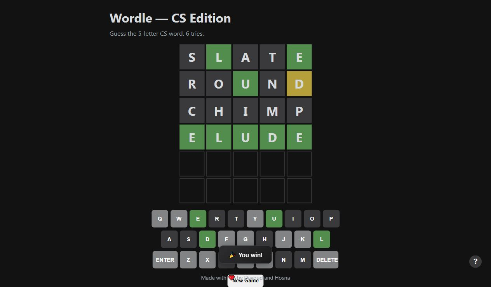
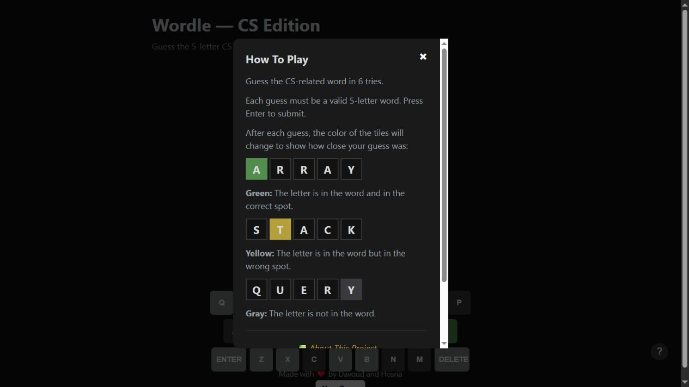

<h1 align="center">Wordle — CS Edition</h1>

<p align="center"><strong>Five letters. Six tries. A vocabulary list drawn from the course.</strong></p>

<p align="center">
  <a href="#how-to-play">How to play</a> &nbsp;·&nbsp;
  <a href="#run-locally">Run locally</a> &nbsp;·&nbsp;
  <a href="#project-files">Project files</a>
</p>

<p align="center">
  
</p>

A browser-based word puzzle built with vanilla HTML, CSS, and JavaScript. This edition draws its answer pool from vocabulary collected for an English for Academic Purposes course.

## How to play

1. Type a five-letter guess with your keyboard or the on-screen keys. Press **Enter** to submit it.
2. Use the feedback on the tiles and keyboard to narrow down the answer. You have six guesses.
3. Select **New Game** at any time, or press **Enter** after a round ends, to start a new round.

| Tile | Meaning |
| --- | --- |
| 🟩 Green | The letter is in the correct position. |
| 🟨 Yellow | The letter appears elsewhere in the answer. |
| ⬛ Gray | The letter has no remaining match in the answer. |

<details>
<summary>See the in-game help panel</summary>
<br>
<p align="center">
  
</p>
</details>

## Run locally

Clone the repository, then open `index.html` in your browser. The game runs directly in the browser without a build step or dependencies.

```bash
git clone https://github.com/HosnaSltn/wordle.git
cd wordle
```

## Project files

| File | What it contains |
| --- | --- |
| [`index.html`](index.html) | Game layout and the in-game help panel |
| [`style.css`](style.css) | Board, keyboard, and tile styling |
| [`script.js`](script.js) | Answer list, game state, keyboard input, and scoring |

The `WORDS` array in [`script.js`](script.js) holds the course vocabulary. The game builds its answer pool from entries that are exactly five characters long and converts them to lowercase.

## Credits

Created by **Davoud and Hosna** for the Fall 2025 Foreign Language course at the **University of Isfahan**, under the guidance of **Dr. A. Ahmadi**.
